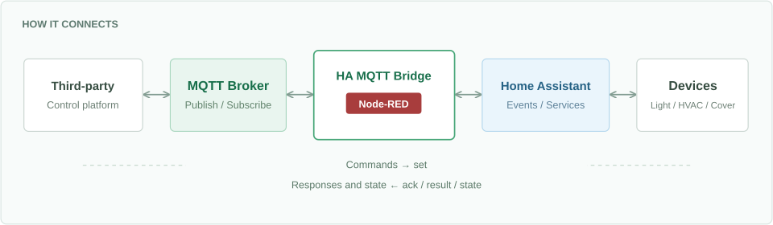
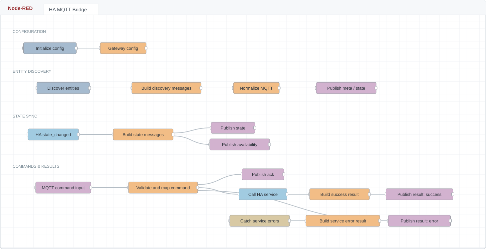

<p align="center">
  
</p>

<h1 align="center">HA MQTT Bridge</h1>

<p align="center"><strong>Read and control Home Assistant devices over MQTT</strong></p>

<p align="center"><a href="README.md">简体中文</a> | <a href="README.en.md">English</a></p>

<p align="center">
  <a href="LICENSE"></a>
  <a href="CHANGELOG.md"></a>
  
  
</p>

<p align="center">
  <a href="#quick-start">Quick start</a> ·
  <a href="docs/mqtt-protocol.zh.md">MQTT protocol</a> ·
  <a href="docs/deployment.zh.md">Deployment</a> ·
  <a href="docs/limitations.zh.md">Known limitations</a>
</p>

---

HA MQTT Bridge is a Node-RED protocol gateway. It exposes Home Assistant lights, climate devices, covers, and other entities through a consistent MQTT topic structure for third-party control platforms, building systems, and custom applications.

Clients subscribe to topics for state updates and publish JSON commands to control devices. The gateway configuration determines which entities, commands, and state fields are exposed.



> **Choose your devices before exposing them.** No entities are exposed by default. Configure a manual list or explicitly enable domain-based exposure. Read-only settings and allowed commands are enforced.

Version `0.1.0` is an early release with an importable flow, configuration examples, Chinese and English READMEs, detailed documentation in Chinese, and offline tests. **No entities are exposed by default.** Configure a manual entity list or explicitly enable automatic exposure by domain.

## Features

| State and control | Configuration and integration |
| --- | --- |
| **Live state updates**<br>Listens for `state_changed` and publishes selected fields. | **Configurable entity exposure**<br>Manual lists, automatic domains, allowlists, and blocklists. |
| **Bidirectional device control**<br>Maps MQTT commands to HA service calls. | **Selected state fields**<br>Keep the attributes you need; brightness uses a percentage. |
| **Clear command responses**<br>`ack` confirms acceptance; `result` reports the call outcome. | **Retained state**<br>New subscribers can receive the most recently reported values. |

## One Flow for Both Directions

Entity discovery, state synchronization, command handling, and result reporting are organized in a single Node-RED flow.



## Supported Domains

| Domain | General control mappings |
| --- | --- |
| `light` | On/off, brightness, color temperature, and related settings |
| `climate` | Temperature, HVAC mode, fan mode, presets, and related settings |
| `cover` | Open, close, stop, and position |
| `fan` | On/off, percentage speed, and presets |
| `switch` | On, off, and toggle |
| `input_button` | Press |
| `scene` | Activate |
| `sensor` | Read-only state |

The code also supports `input_boolean`, which can be configured manually or added to the automatic exposure lists. Actual commands and parameters depend on the device. A domain-level mapping is not automatic capability detection for every device.

## Quick Start

Prepare working Home Assistant, Node-RED, and MQTT Broker instances. Install the `node-red-contrib-home-assistant-websocket` node package in Node-RED.

1. Import [flows/ha-mqtt-bridge.json](flows/ha-mqtt-bridge.json) into Node-RED.
2. Edit the `Home Assistant` configuration node. Use Add-on mode inside the HAOS add-on; for an external Node-RED instance, enter your own HA URL and access token.
3. Edit the `Local Mosquitto` configuration node with your Broker address and credentials. The template hostname is `core-mosquitto`; no username or password is included.
4. Open the `Gateway config` Function and replace `entities: []` with your entity list, for example:

```js
entities: [
    {
        entity_id: "light.example",
        name: "Example Light",
        writable: true,
        commands: ["turn_on", "turn_off"],
        enabled: true
    }
],
```

5. Replace the fictional `light.example` with your actual entity ID and deploy. Wait for the HA and MQTT connections, then click `Init gateway config`, followed by `Discover entities on deploy and every 10 min`.
6. Subscribe to that entity's `state` topic. If discovery reports `published 0 entities`, check the entity ID, configuration initialization, and HA state cache.

The importable flow already embeds the full [config/gateway.config.js](config/gateway.config.js). There is no additional Function replacement step. See the [deployment guide (Chinese)](docs/deployment.zh.md) for automatic exposure, configuration details, and troubleshooting.

## Control Example

For the fictional device `light.example`, subscribe to:

```text
gw/home/entity/light.example/state
gw/home/entity/light.example/ack
gw/home/entity/light.example/result
```

Publish this JSON to `gw/home/entity/light.example/set` to turn on the light at 75% brightness:

```json
{
  "request_id": "demo-001",
  "command": "turn_on",
  "params": { "brightness_pct": 75 }
}
```

`result.status=success` means the service call completed. Use `state` to determine the device's reported state; it may arrive before `result`. Do not publish control commands with the retained flag.

A state subscription reads the latest reported value, not a fresh device measurement on demand. Keep the subscription active to receive subsequent updates. With `mosquitto_sub`, `-C 1` exits after one message; omit it for continuous monitoring.

## Documentation

The detailed guides below are currently in Chinese; command names, topics, and JSON examples are language-independent.

- [Deployment and configuration](docs/deployment.zh.md): importing, manual/automatic exposure, field selection, migration, and troubleshooting.
- [MQTT protocol](docs/mqtt-protocol.zh.md): topics, payloads, commands, and responses.
- [CLI examples](examples/mosquitto.sh): connection settings come from environment variables; no real credentials are included.
- [Known limitations](docs/limitations.zh.md): availability, duplicate commands, capability checks, and test scope.
- [Contributing](CONTRIBUTING.md): building, testing, and reporting issues.
- [Changelog](CHANGELOG.md).

## Development and Checks

The local maintenance scripts require Node.js 20 or later. There are currently no npm package dependencies, so `npm install` is not required.

```bash
npm run check
```

This command rebuilds the flow, validates node configuration and Function syntax, runs core mapping and exported Function tests, and scans release files. It does not connect to HA or MQTT or control real devices.

After changing `config/gateway.config.js` or the flow generator, run `npm run build:flow`, then `npm run build:assets` to update the flow diagram and version badge. `npm run check` runs these steps in order. Do not edit only the generated files: the next build will overwrite them. Keep deployment-specific configuration in a separate backup, outside the public repository.

## Scope and Limitations

This is an early, configurable gateway template, not an industrial gateway certified across all devices and failure scenarios. Persistent command deduplication, complete HA connection-health tracking, and automatic per-device capability validation are not implemented. Perform deployment-specific acceptance tests using the [known limitations](docs/limitations.zh.md) as a reference.

All example names and addresses are placeholders. The repository does not include deployment inventories, historical state snapshots, HA access tokens, or MQTT login credentials.

## License

This project is licensed under the [Apache License 2.0](LICENSE). Node-RED, Home Assistant, MQTT Brokers, and node packages are separate dependencies governed by their respective licenses; they are not bundled in this repository.
