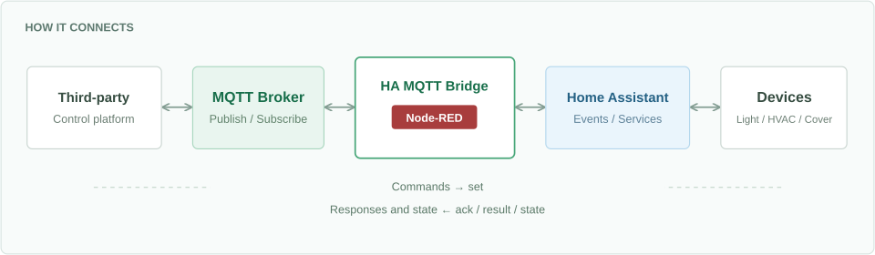
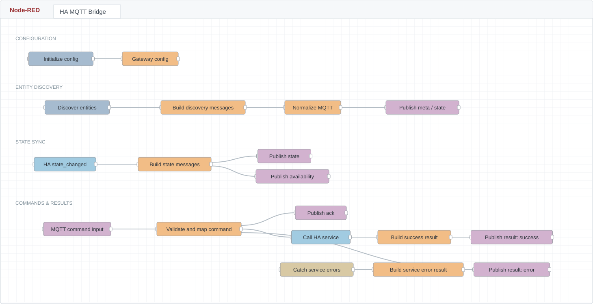

<p align="center">
  
</p>

<h1 align="center">HA MQTT Bridge</h1>

<p align="center"><strong>通过 MQTT 读取和控制 Home Assistant 设备</strong></p>

<p align="center"><a href="README.md">简体中文</a> | <a href="README.en.md">English</a></p>

<p align="center">
  <a href="LICENSE"></a>
  <a href="CHANGELOG.md"></a>
  
  
</p>

<p align="center">
  <a href="#快速开始">快速开始</a> ·
  <a href="docs/mqtt-protocol.zh.md">MQTT 协议</a> ·
  <a href="docs/deployment.zh.md">部署文档</a> ·
  <a href="docs/limitations.zh.md">已知限制</a>
</p>

---

HA MQTT Bridge 是一个基于 Node-RED 的协议网关。它将 Home Assistant 中的灯、空调、窗帘和其他实体转换为统一的 MQTT Topic，供第三方中控、楼宇系统或自建应用对接。

第三方订阅 Topic 获取状态，发布 JSON 命令控制设备。实体暴露范围、允许的命令和状态字段由网关配置管理。



> **先选择设备，再开始暴露。** 默认不暴露任何实体；手动指定设备，或主动开启按类型自动暴露。支持只读设置与命令白名单。

当前为 `0.1.0` 早期版本，提供可导入 flow、配置示例、中英文 README、中文详细文档和离线测试。**默认不暴露任何实体**，需要先配置实体列表或主动开启按类型自动暴露。

## 能做什么

| 状态与控制 | 配置与接入 |
| --- | --- |
| **实时状态同步**<br>监听 `state_changed`，持续推送选定字段。 | **可配置的设备暴露**<br>手动列表、自动模式、白名单与排除名单。 |
| **双向设备控制**<br>将 MQTT 命令转换为 HA 服务调用。 | **精简状态字段**<br>选择所需属性，亮度统一为百分比。 |
| **清晰的命令回执**<br>`ack` 确认接受，`result` 返回调用结果。 | **保留最近状态**<br>新订阅者可读取最近一次上报。 |

## 一份 flow，打通双向通信

实体发现、状态同步、命令处理与结果回传，集中在一个 Node-RED 流程中。



*根据公开导出 flow 绘制的布局示意，非现场运行截图。图内标签使用英文，中英文 README 共用同一份图片。*

## 支持类型

| 类型 | 通用控制能力 |
| --- | --- |
| `light` | 开关、亮度、色温等 |
| `climate` | 温度、运行模式、风速、预设等 |
| `cover` | 打开、关闭、停止、位置 |
| `fan` | 开关、百分比风速、预设 |
| `switch` | 开、关、切换 |
| `input_button` | 触发按钮 |
| `scene` | 激活场景 |
| `sensor` | 只读状态 |

代码另有 `input_boolean` 映射，可手动配置或加入自动暴露类型。实际支持哪些参数取决于设备，类型命令表不等于逐设备能力检测。

## 快速开始

准备可运行的 Home Assistant、Node-RED、MQTT Broker，以及 `node-red-contrib-home-assistant-websocket` 节点包。

1. 在 Node-RED 导入 [flows/ha-mqtt-bridge.json](flows/ha-mqtt-bridge.json)。
2. 编辑 `Home Assistant` 配置节点。HAOS Add-on 内使用 Add-on mode，外部 Node-RED 填写自己的 HA 地址和令牌。
3. 编辑 `Local Mosquitto` 配置节点，填写自己的 Broker 地址、账号和密码。模板默认主机名为 `core-mosquitto`，没有内置账号密码。
4. 打开 `Gateway config` Function，将其中 `entities: []` 改为自己的实体列表，例如：

```js
entities: [
    {
        entity_id: "light.example",
        name: "示例灯",
        writable: true,
        commands: ["turn_on", "turn_off"],
        enabled: true
    }
],
```

5. 将虚构的 `light.example` 换成实际实体 ID，点击部署。等待 HA 和 MQTT 连接就绪，依次点击 `Init gateway config`、`Discover entities on deploy and every 10 min`。
6. 订阅该设备的 `state` 验证结果。首次显示 `published 0 entities` 时，检查实体 ID、配置是否初始化，以及 HA 状态缓存。

导入文件已经包含 [config/gateway.config.js](config/gateway.config.js) 的完整配置，不需要再替换另一份 Function。完整部署过程、自动模式与排障见 [部署指南](docs/deployment.zh.md)。

## 一个控制示例

以虚构设备 `light.example` 为例，订阅：

```text
gw/home/entity/light.example/state
gw/home/entity/light.example/ack
gw/home/entity/light.example/result
```

向 `gw/home/entity/light.example/set` 发布以下 JSON，开灯并设置 75% 亮度：

```json
{
  "request_id": "demo-001",
  "command": "turn_on",
  "params": { "brightness_pct": 75 }
}
```

`result.status=success` 表示服务调用完成，设备最终状态以 `state` 为准。状态可能早于 result 到达。发送控制命令时不要启用 retained。

查询读取的是最近一次上报。持续监听不需要反复订阅；使用 `mosquitto_sub` 时，`-C 1` 会在收到一条消息后退出，实时监听应移除它。

## 文档

- [部署与配置](docs/deployment.zh.md)：导入、手动/自动模式、属性筛选、迁移和排障。
- [MQTT 协议](docs/mqtt-protocol.zh.md)：Topic、消息结构、类型命令和回执。
- [测试命令](examples/mosquitto.sh)：从环境变量读取连接参数，不包含真实账号。
- [已知限制](docs/limitations.zh.md)：离线状态、重复命令、能力校验和测试范围。
- [参与贡献](CONTRIBUTING.md)：构建、测试和问题反馈。
- [更新记录](CHANGELOG.md)。

## 开发与验证

本地维护脚本要求 Node.js 20 或更高版本；当前没有 npm 包依赖，无需 `npm install`。

```bash
npm run check
```

该命令重新生成 flow，检查节点与 Function 语法，运行核心映射及导出 Function 测试，并扫描发布文件。它不连接 HA 或 MQTT，不会控制真实设备。

修改 `config/gateway.config.js` 或 flow 生成器后，运行 `npm run build:flow`，再用 `npm run build:assets` 更新流程图和版本徽章。`npm run check` 会按顺序完成这些步骤。不要只改生成后的文件；重新构建会覆盖它们。现场自定义配置应单独备份，不提交到仓库。

## 使用边界

本项目是可配置的早期网关模板，不是已完成所有设备与异常场景认证的工业网关。当前没有持久化命令去重、完整的 HA 连接健康判断或逐设备能力自动校验。请按 [已知限制](docs/limitations.zh.md) 完成现场验收。

所有示例名称和地址均为占位内容。仓库不包含现场目录、历史状态缓存、HA 访问令牌或 MQTT 登录凭据。

## 许可证

本项目采用 [Apache License 2.0](LICENSE)。Node-RED、Home Assistant、MQTT Broker 及节点包是独立依赖，遵循各自许可证；本仓库不打包这些依赖。
